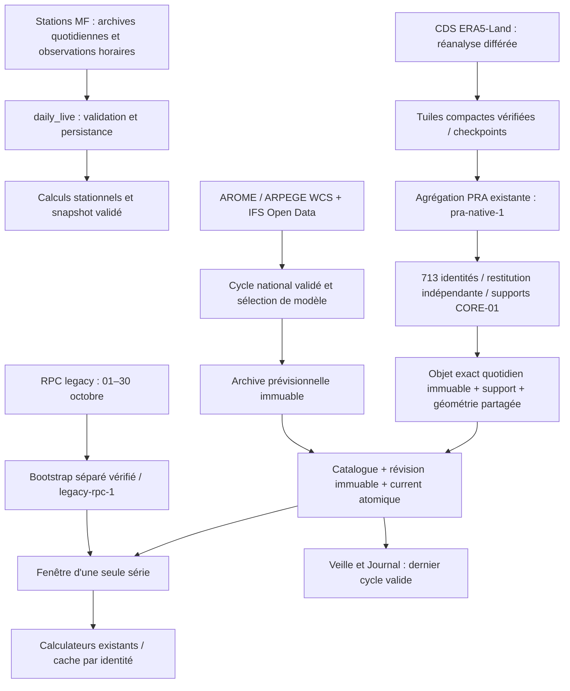

# DATA-01 — audit de la chaîne réelle

Audit du 8 novembre 2026, base `10d9dbf` (PR #64 fusionnée). #63 consultée à
`origin/codex/COUV-01-national-climate-foundation`, sans merge. Reprise ciblée de
`archive_legacy_pra_reads.py` ; les trois documents de stratégie, reprise et budget
ont été examinés. Aucune bascule SAFRAN ni modification des calculateurs scientifiques.

## Inventaire

Les horaires ci-dessous sont ceux du code, en UTC, et ne prouvent pas une exécution.
Les fichiers `evidence/*.yml.json` conservent jusqu'à 30 exécutions récentes par
workflow ; les reçus `.jobs.json` détaillent le dernier schedule présent dans cet
échantillon. Les anciennes exécutions peuvent correspondre à un ancien YAML.

| Workflow | Déclenchement actuel | Condition / portée |
|---|---|---|
| daily-live | 07:40 UTC chaque jour + manuel | schedule si `AGRICLIMAX_DAILY_ENABLED=true` ; stations, persistance, calculs, snapshot |
| pra-climate | 08:20 UTC chaque jour + choix manuels | `PRA_CLIMATE_DAILY_DEV_ENABLED`, kill switch ; météo et archives DEV, reprises séquentielles |
| meteofrance-ingestion | manuel | ingestion stations ou sonde lecture seule ; pas de cron actuel |
| data-ingestion | 06:20 UTC + manuel | fixtures explicitement fictives, cache local / artefact, sans secrets de production |
| agriculture-annual | 06:17 UTC le 15 juillet/novembre + manuel | références agricoles ; aucune exécution dans l'échantillon |
| task12-era5-real-validation | manuel | validation bornée ERA5 ; artefacts sept jours |
| quality / security | PR, push main, manuel | contrôles ; ne constituent pas une ingestion météo |

`batch`, `daily-pilot`, `national-daily`, `operational-pilot`, `weather-preflight`,
`weather-masks`, `weather-coastal-review`, `weather-humidity-review` sont des modes
manuels du workflow PRA. Les sélections de modes, `execute`, `national_authorized`,
`publish_dev` et la concurrence globale `pra-climate-batches` bornent les écritures.
Les booléens du YAML ne constituent pas une autorisation pour cette session.
La lecture des valeurs des variables GitHub est refusée (HTTP 403). Leur état
actuel n'est donc pas certifié ; les jobs observés prouvent seulement leur état
au moment du run correspondant.

## Exécutions observées

Le 7 novembre : daily-live est créé à 14:18:34 UTC et échoue en 22 s de job,
au lieu du cron nominal 07:40 (retard d'environ 6 h 39). Le workflow PRA est créé
à 14:55:27 UTC, environ 6 h 35 après 08:20. national-weather échoue après 9 min 40 ;
era5-archive échoue après 22 min 30 ; era5-resume-1 réussit en 70 s ; weather-health
réussit en 35 s. Le workflow reste en échec : une reprise ERA réussie ne répare
pas le modèle météo en échec. Le job health vert ne suffit pas à prouver le succès
de toute la chaîne. Les durées incluent préparation et vérifications ; les temps
purs acquisition/agrégation nécessitent les reçus de stage, non déduits de ces durées.
Le workflow fixtures réussit en 20 s : ce succès ne valide aucune donnée réelle.

## Sources et dépendances

ERA5 : dernier jour Storage constaté **01/11** ; catalogue legacy **01–30/10**.
Le plafond J−6 du writer est une garde conservatrice, pas une interrogation de la
livraison CDS. AROME/ARPEGE sont des champs de modèle ; IFS fournit le prolongement
prévisionnel, avec changement de modèle explicitement qualifié. Aucun de ces
champs n'est une observation stationnelle. Le dernier cycle Storage est du
07/11 00 UTC. Les résultats du preflight actuel sont distincts de cet archivage.
Les API MF exigent les droits propres aux produits, pas uniquement une clé existante.

## Échecs, publication et rétention

CDS peut attendre ou dépasser le budget ; WCS peut refuser une couverture, retourner
une réponse tronquée ou un champ incomplet ; IFS peut manquer un index/range ; les
supports/variables peuvent être incomplets. Les retries bornés, tuiles compactes,
empreintes et reçus existants sont réutilisés. Le kill switch reste inchangé.
Les blobs sont chargés et relus avant les pointeurs. DATA-01 conserve aussi les
révisions du catalogue, puis remplace `current.json` en une écriture d'objet.
La cohérence repose sur l'unique groupe de concurrence : Storage ne fournit pas
ici une transaction multi-objets ni une exclusion entre écrivains externes.
Un arrêt entre catalogue et current exige la réparation DEV explicite documentée.

Checkpoints ERA/météo : trois jours ; anciens batches : sept jours ; preuves de
supervision : trente jours. Cela ne remplace jamais Storage. Aucune purge n'est
ajoutée ; les objets orphelins éventuels après interruption restent conservés.

## Vérification complémentaire des accès

La sonde lecture seule existante a été exécutée le 08/11 après le preflight :
AROME et ARPEGE `binding_absent` ; catalogues observations v1, observations v2,
paquet observations v2 et climatologie quotidienne : **HTTP 401**. La présence de
liaisons stations ne suffit donc pas à démontrer leur autorisation effective.
Les dates fournisseur stationnelles ne peuvent pas être certifiées dans cette
session. Reçu sans secrets : `evidence/provider-access.json`.
