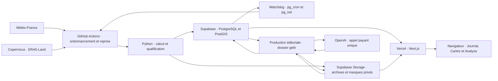
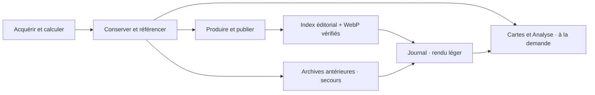

# OPTI-01A · Décision d’architecture

**Décision du 27 novembre 2026.** Garder GitHub, Supabase et Vercel. Publier les projections dans le bucket Supabase privé existant, puis mesurer pendant cinq à sept jours. La période Pro décidée par le propriétaire sert à observer les quotas et sécuriser les opérations. Le retour à Free dépend des mesures et de l’échéance affichée sur le compte.

## Architecture en service

GitHub porte le code et les exécutions. PostgreSQL conserve le registre, les références et l’archive éditoriale, Storage conserve les objets scientifiques et les rendus immuables. Les géométries publiques stables sont déjà servies par Next depuis `public/maps`. Le watchdog est une tâche SQL. La liste des Edge Functions était vide lors d’OPTI-01. Le mail utilise les états du pipeline et une sonde publique distincte. Les dépendances optionnelles incluent la recette locale et l’adaptateur S3, sans rôle dans l’exploitation initiale. [Audit](AUDIT.md) · [Architecture](ARCHITECTURE.md)

| Complexité constatée | Utilité et risque | Simplification |
|---|---|---|
| Découverte de l’édition, liste d’archives et sonde peuvent consulter le même registre | La disponibilité et les révisions doivent rester fraîches | Grouper les lectures concurrentes et cibler une date dans l’API. Conserver le registre comme autorité. |
| Les dates historiques sans projection peuvent lire des bundles pour valider leur accès | Le contrôle protège la cohérence des cartes et des révisions | Rétroalimenter par date et par identifiant. Réserver toute évolution du catalogue à une validation ultérieure. |
| Cache HTTP, cache de processus et cache Storage enregistrent des métriques différentes | Le cache Storage compte toujours en egress Supabase lors d’une lecture en amont | Utiliser les URL immuables au CDN et réutiliser l’index pour les réponses conditionnelles. |
| Watchdog, rattrapage manuel et budget éditorial ont des rôles proches | Ils protègent des pannes différentes, notamment un appel au statut incertain | Conserver verrous et états. Réutiliser le workflow INT-01 pour la projection. |
| Masques copies entre racine et cycles et checkpoints GitHub temporaires | Leur provenance ou les références historiques peuvent diverger | Vérifier SHA et graphe avant toute décision de rétention. |

## Comparaison pondérée

Notes de 1 à 5, cinq étant le meilleur résultat. Coûts et charge d’exploitation sont indicatifs. Les fournisseurs désignent le socle d’hébergement. OpenAI et les sources de données restent communs aux scénarios.

| Scénario | Maintenance 30 % | Fiabilité 25 % | Coût 20 % | Évolution 15 % | Transition 10 % | Score / 5 |
|---|---:|---:|---:|---:|---:|---:|
| A · Supabase Free optimisé + cache Vercel | 5 | 3 | 5 | 4 | 5 | 4,35 |
| B · Supabase + Vercel Blob | 4 | 3 | 4 | 4 | 3 | 3,65 |
| C · Supabase + Cloudflare R2 | 3 | 4 | 4 | 5 | 2 | 3,65 |
| D · Supabase + GitHub dédié aux publications | 3 | 3 | 4 | 2 | 3 | 3,05 |
| E · Supabase Pro optimisé | 5 | 5 | 2 | 4 | 5 | 4,25 |
| F · PostgreSQL/PostGIS et application sur VPS | 2 | 2 | 3 | 4 | 1 | 2,40 |

| Scénario | Exploitation et justification |
|---|---|
| A | Trois fournisseurs, zéro nouveau secret ou workflow. Une seule autorité par type d’objet. Le risque est la pression des quotas d’organisation et le réchauffement de plusieurs régions CDN. Sauvegarde indépendante et retour par deux drapeaux. |
| B | Trois fournisseurs et un service supplémentaire. Au moins un token privé supplémentaire, potentiellement une identité d’écriture séparée. Publication par API sans redéploiement, lecture privée via fonction et transfert Vercel. Sauvegarde et restauration des nouvelles clés. Intérêt si l’origine du Journal reste le poste qui bloque. |
| C | Quatre fournisseurs et une paire de clés S3 par identité. Les masques et archives volumineuses peuvent sortir de l’enveloppe d’egress Supabase. Étapes supplémentaires de copie, contrôle, localisation UE, synchronisation et retour. Pertinent si les cartes ou masques maintiennent la consommation au-dessus des quotas. |
| D | Trois fournisseurs, dépôt et politique de publication supplémentaires, accès d’écriture inter-dépôt à prévoir. Pages ou Releases permettent une diffusion de contenus publics. Le maintien de l’autorité éditoriale et la conservation privée accroissent la charge. |
| E | Trois fournisseurs, mêmes secrets, workflows et sauvegardes. Plus de marge et prix de base d’environ 25 USD/mois pour Supabase hors Vercel. Bons choix de continuité à court terme si les quotas rendent A impraticable. |
| F | Deux ou trois fournisseurs selon la place de Vercel. Administration Linux, PostgreSQL, réseau, TLS, sauvegardes, tâches et surveillance à la charge du propriétaire. Plusieurs heures de maintenance par mois sont une hypothèse à tester. Point de panne unique et migration des dépendances Supabase. |

Les horaires, qualifications et algorithmes agroclimatiques restent communs. Les options gérées favorisent la continuité et la réversibilité avec la région Supabase existante. R2 propose une juridiction UE. Pour Blob et GitHub, vérifier l’emplacement et les obligations avant tout transfert de données privées. Si la note fiabilité de A chute à 2, E devance A. Pendant Pro, mesurer les seuils plutôt que forcer le classement. [Comparaison des coûts](COUTS.md) · [Réserve R2](MIGRATION-R2.md)

## Décision progressive

- **Maintenant.** Finaliser la PR, préparer le 27 sur Supabase, activer séparément l’écriture et la lecture avec accord du propriétaire. Préserver l’accès aux archives historiques.
- **Sur le cycle Pro.** Mesurer cinq à sept jours, sauvegarder, puis examiner la tendance mensuelle et la marge par quota. Garder Pro si la restauration, la stabilité ou la marge reste insuffisante. [Runbook](RUNBOOK.md)
- **À six mois et au-delà.** Réexaminer Blob si la projection légère représente la charge bloquante. Réexaminer R2 si les masques ou cartes scientifiques dépassent durablement le budget, après cache et réduction des lectures. Garder VPS, Supabase auto-hébergé, calcul local avec publication cloud et hébergement local intégral comme scénarios de capacité et de compétences, selon les besoins des bêta-testeurs. [Architecture](ARCHITECTURE.md)
