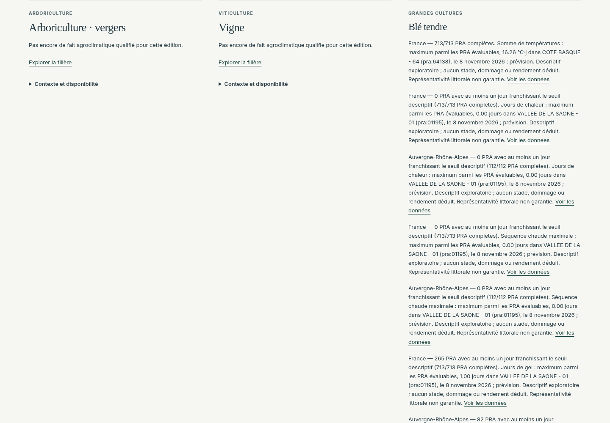

# Intégration AGRO-01 sur T32B — 8 novembre 2026

La branche de la PR #62 intègre `origin/main` à `60842d2610da90b712f94d068a867a2818023fd4` (PR #61) par le commit de synchronisation `a28b1e1`. La fusion ne présente aucun conflit. Les fichiers de présentation du Journal, dates éditoriales, chiffres de une, carte PRA et route `/api/journal/map` sont identiques à T32B. Aucune méthode scientifique, règle, seuil, unité, qualification ou dépendance n'a été modifié durant cette synchronisation. Aucun merge de PR ni déploiement de production réalisé.

## Frontières vérifiées

- Adaptateur `WheatEditorialContributor` → registre synchrone → `buildEdition` : seules les synthèses vérifiées du même cycle/source et contenues dans la fenêtre du Journal sont publiées.
- Composition serveur : erreur ou délai blé borné à 1 500 ms n'empêche pas la publication nationale ; absence de détail privé dans les réponses et nouvelle tentative à la consultation suivante (tests existants conservés et réussis).
- Présentation T32B : `ProductionStoryCard` affiche les faits qualifiés, dates françaises et liens d'analyse exacts. Les preuves du footer reprennent les mêmes identifiants, valeurs, unités, provenance, fraîcheur, règle et réserves. L'inventaire des périodes indisponibles reste consultable.
- Carte PRA : contexte météo de la veille nationale conservé ; les indicateurs blé J+1 ne sont pas substitués à la carte météo sur sept jours. Les trois chiffres éditoriaux gardent leurs propres dénominateurs et critères T32B.

Deux tests de contrat/rendu ajoutés dans `features/wheat/editorial.test.ts` couvrent la carte générique de filière avec les dix indicateurs, les preuves de l'édition, les liens vers la période/PRA/cycle exacts et le refus de fenêtres hors édition. Les tests synthétiques restent limités aux tests unitaires.

## Recette navigateur réelle

Build de production Next.js, Chromium système via Playwright, services d'archives existants en lecture seule. Aucun remplacement de réponse météo ni fixture scientifique. La simulation d'échec réseau de carte appartient au scénario de résilience T32B.

| Recette | Résultat |
|---|---|
| Script T32B original, desktop 1440, tablette 768, mobile 390 | **58 contrôles réussis**, aucune erreur page ou console |
| Extension blé, desktop 1440 et mobile 390, cycles courant et archivé | **105 contrôles réussis**, aucune erreur page |
| Cycle courant vérifié | `2026-11-07T00:00:00+00:00`, faits blé du 8 novembre |
| Cycle archivé vérifié | `2026-11-06T00:00:00+00:00`, faits blé du 7 novembre |
| Chaque cycle | **10 indicateurs, 18 faits**, ETag 304 à la répétition |
| Période de sept jours | Dix indicateurs indisponibles dans l'inventaire, aucune valeur publiée |
| Affichage | Tous les faits blé visibles, dates françaises, zéro publiable distinct d'une indisponibilité, limites exploratoires explicites |
| Traçabilité | 18 références par édition, règle et provenance ouvrables ; liens conservant début/fin, cycle et PRA |
| Carte | 713 PRA, valeurs comparées à la veille pour cinq phénomènes, ETag, sélection, cycle archivé et changement de provenance, clavier, activation tactile, pas de requête de données en double |
| Résilience | Cycle historique absent : 503/no-store ; panne carte : titre et trois chiffres de une conservés |

Les fenêtres J+1 et sept jours sont explicitement différentes. Une mesure descriptive ne devient jamais un risque agronomique validé. Le dernier cycle accessible reste daté du 7 novembre, même si la recette est exécutée le 8.

Rapports : [carte](evidence/t32b/map/report.json), [blé](evidence/t32b/wheat/report.json). Reproduction : lancer le build sur `127.0.0.1:3002`, puis `TASK32B_OUTPUT=docs/codex/agro01/evidence/t32b/map node apps/web/features/journal/ui/browser-task32b.mjs` et `node docs/codex/agro01/browser-t32b.mjs`. Activer le proxy hérité pour le processus serveur Node dans cet environnement cloud (`NODE_USE_ENV_PROXY=1`).

## Contrôles locaux finaux

| Contrôle | Résultat |
|---|---|
| Vitest complet | **393 réussis**, 4 tests réels opt-in ignorés ; recette HTTP/navigateur réelle effectuée séparément |
| Python moteur | **341 réussis**, 63 avertissements préexistants NumPy/netCDF4/xarray |
| Tests qualité | **12 Python + 8 Node réussis** |
| Lint, typecheck, build | Réussis |
| Contrats, migrations, sécurité sources/bundle, secrets client | Réussis |
| Budget JS/CSS gzip | **648 920 octets**, inchangé par rapport à T32B |
| Audit JS production et outils navigateur | Aucune vulnérabilité connue |
| Audit JS toutes classes, seuil bloquant high | Réussi ; **une alerte modérée préexistante** `GHSA-g3hv-75wg-m249`, `minimatch@10.2.6` transitif des outils ESLint. Non présent dans les dépendances de production. Aucun contournement ajouté. |
| Audits Python sur les six fichiers lock de la CI | Aucune vulnérabilité connue |
| Gitleaks intégralité de l'historique | Aucune fuite détectée ; version 8.24.2 et checksum de la CI |

Les premiers essais d'installation ont nécessité un cache local au workspace, le chemin pnpm 10 et `PYTHONPATH=engine/src` pour les tests Python. Leurs exécutions finales sont réussies. Le binaire Gitleaks a été récupéré après un 504 temporaire du téléchargement.

## Captures d'intégration

[Carte PRA et une conservées](evidence/t32b/map/desktop-front-page.png) · [Intégration mobile](evidence/t32b/wheat/mobile-current-integration.png) · [Carte complète du blé](evidence/t32b/wheat/desktop-current-wheat.png) · [Preuve dépliée](evidence/t32b/wheat/desktop-current-proof.png)

## Vérification complémentaire de la nouvelle preview

La preview Vercel du commit applicatif `a6f82c4` est disponible : https://agriclimax-git-codex-agro-01-wheat-8f23a1-mehdi-sines-projects.vercel.app/journal. Les **58 contrôles navigateur T32B passent également à distance**, sans erreur page ou console : [rapport](evidence/t32b/preview/report.json). Les deux cycles API renvoient **10 indicateurs / 18 faits**, avec les mêmes identités d'édition que le build local : [résultats API](evidence/t32b/preview/wheat-api.json).

Le premier appel API distant a renvoyé le Journal sans enrichissement blé ; les appels suivants publient bien les dix indicateurs et dix-huit faits. Cette observation confirme la reprise après indisponibilité, sans permettre d'attribuer à elle seule le premier repli à un timeout plutôt qu'à un échec d'archive. Le plafond serveur de 1 500 ms reste inchangé.

CI sur `a6f82c4` : Security audits réussie ; jobs Quality Python et SQL public/extensions réussis. Le job `guards` a été interrompu par un HTTP 504 pendant le téléchargement d'Actionlint 1.7.7, avant exécution du binaire. Aucun défaut de workflow n'est déduit de ce téléchargement échoué. Le même téléchargement est indisponible lors du contrôle local complémentaire ; les garde-fous sources, migrations et les suites qualité exécutés séparément réussissent. Le job web distant est encore en cours au relevé. Ces statuts distants sont distincts des validations locales complètes ci-dessus.
