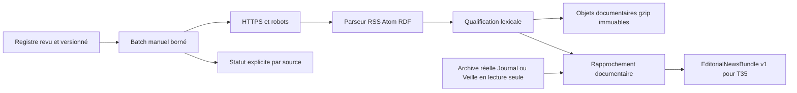

# Collecte documentaire indépendante



Python standard + Pydantic déjà utilisé dans le projet ; aucune dépendance runtime nouvelle. Le paquet `agriclimax.news` ne dépend d’aucun calculateur ou service web. L’adaptateur de lecture consomme les formes existantes `JournalEdition` et `WatchSummary` et ne change pas leurs contrats. Le JSON Schema documentaire vit dans ce dossier pour ne pas modifier `contracts/` partagé.

## Exécution et limites

```sh
python -m pip install -e 'engine[dev]'
python scripts/task34_news.py \
  --output work/task34/archive \
  --events docs/codex/agro01/evidence/journal.json \
  --bundle work/task34/review.json
```

Le chemin d’archive est local et explicite. Aucun secret requis. Aucun appel au chargement du Journal. Sans `--events`, la collecte fonctionne et les listes d’événements/liens sont vides. Une source inaccessible n’interrompt pas les autres. Un registre invalide ou une archive événementielle incompatible fait échouer le batch avant archivage plutôt que de produire des références trompeuses. Code de sortie 2 si aucune source ne réussit ; les statuts restent exportables et archivables.

Budgets : au plus 10 entrées, 250 items par flux, 1 Mo par réponse flux, 32 ko robots, deux tentatives au maximum pour erreurs réseau/5xx, temporisation 0,5 s entre tentatives. Pas de retry sur 403, 429 ou redirection : prochaine fenêtre contrôlée/opérateur. Timeout socket 10 s, contrôle de durée pendant la lecture, pas de téléchargement décompressé non borné : compression refusée. Le délai DNS du système et la latence du proxy ne constituent pas un engagement temps réel ; l’orchestrateur futur doit aussi fixer une limite globale de job.

HTTPS seulement, hôtes exacts configurés, aucun identifiant URL, port alternatif, fragment ou caractère de contrôle ; validation des adresses DNS publiques avant acquisition ; aucune redirection, aucun téléchargement depuis les liens d’items. Les URL d’articles sont validées lexicalement sans requête. Les URL, droits et hôtes viennent exclusivement d’un registre administré dans Git, jamais d’une entrée visiteur. Le proxy cloud demeure une seconde protection de sortie ; ce code n’est pas un proxy HTTP général. La résolution locale n’est pas un mécanisme autonome de pinning DNS pour un registre hostile : le registre et les domaines approuvés restent une frontière de confiance.

Archives événementielles limitées à 8 Mo et 1 000 lignes brutes, rapprochement à 500 événements uniques, 2 500 publications et 10 000 liens par fenêtre ; dépassement explicite en erreur, sans troncature silencieuse. XML UTF-8, racines RSS/RDF/Atom reconnues, DTD et entités déclarées refusées, quotas en octets et items. Pas d’exécution HTML/JS ; catégories et résumés nettoyés en texte. L’absence de date ou de fuseau reste explicite. Une source protégée renvoyant du HTML est indisponible, même avec HTTP 200. Les états exposent les empreintes, volumes et durées. Les compteurs de tentatives couvrent les réponses et les échecs réseau/HTTP ; un échec précoce sans réponse n’a pas de volume de corps mesuré.

## Stockage et reprise

Identité : SHA-256 d’URL canonique ; paramètres UTM/fbclid/gclid retirés, paramètres métiers conservés. Révision : contenu autorisé, configuration de source et version du qualificateur. Une modification crée un nouvel objet. L’heure de collecte et l’empreinte du flux sont dans le reçu/bundle, sans forcer une nouvelle copie de chaque document inchangé.

`publications/<id>.<revision>.json.gz` contient les métadonnées normalisées. Les reçus gzip contiennent statut, références aux documents, événements et liens, empreinte registre et archive événementielle. Écriture temporaire complète puis lien atomique sans écrasement. Une interruption peut laisser des objets sans reçu, jamais un reçu pointant sur un fichier incomplet ; rejouer le batch reprend les objets existants. Un conflit sur un objet immuable est une erreur explicite. Pas de purge ni modification d’archive météo.

L’export complet `--bundle` facilite la revue/T35 ; ne pas le recopier chaque jour comme stockage historique principal. Une adaptation ultérieure au stockage objet existant est possible, mais aucune écriture de production n’a été faite dans T34.

## Fenêtre éditoriale préparée, non activée

Proposition : déclenchement unique vers 05 h 45 **Europe/Paris**, budget global 10 min, reprise opérateur bornée avant 06 h 10, gel documentaire à 06 h 15, puis T35 et revue des portes de publication avant 06 h 30. Utiliser un ordonnanceur comprenant `Europe/Paris` et ses changements d’heure ; ne pas coder une constante UTC. Concurrence batch = 1. Les publications arrivant après le cutoff passent à la prochaine édition. Conserver l’heure effective du batch et les dates source ; ne pas prétendre que toute actualité du jour est déjà livrée.

Aucun cron/workflow n’est créé ou modifié. L’ordonnanceur futur doit sélectionner le dernier reçu complet, vérifier sa fraîcheur et afficher les sources manquantes. Repli sur un bundle antérieur explicitement périmé, ou aucune actualité ; jamais de texte factuel inventé pour compléter.
