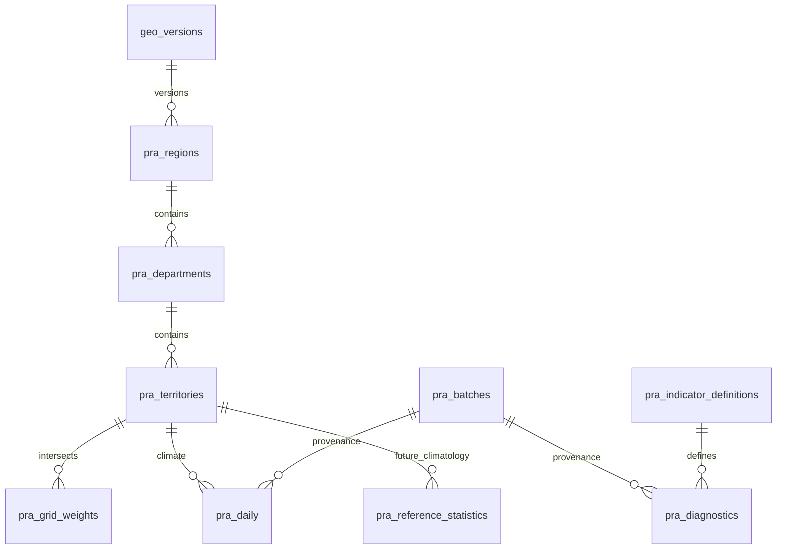

# Schéma additif

Migration : `20261017190818_pra_territorial_aggregation.sql`, générée avec CLI
Supabase puis complétée. **Appliquée seulement dans des conteneurs PostGIS locaux
jetables ; aucune application distante DEV/production.**

Toutes ces tables sont dans `agriclimax_private`. Codes texte, PK composites par
version ; géométries uniquement dans la référence, GiST séparé. Lignes quotidiennes
larges avec quatre scalaires, compteurs et couvertures courts ; pas une série
par production ni une table par indicateur. Diagnostics sparse selon demande,
paramètres fingerprintés, métadonnées de règle normalisées. Provenance détaillée
une fois par batch, référencée par les sorties ; pas de payload horaire en DB.

Nouvelles RPC :

- `agriclimax_persist_pra` : au plus sept jours, transaction atomique, lock
  d’ingestion, clés/rejeu et empreintes géométrie/poids contrôlés, conflit de valeurs exigeant nouvelle révision,
  arrêt à la cible DB 375 MB. Reçu après transaction, checkpoint après succès.
- `agriclimax_pra_lookup` : filtre PRA/département/région, recherche, curseur, 100 max.
- `agriclimax_pra_read` : PRA/département/région/France, date/révision explicites,
  100 PRA max, absence null et statut unavailable, aucune moyenne implicite.
- `agriclimax_pra_diagnostics` : une PRA, fenêtre et fingerprint explicites,
  huit indicateurs blé existants max ; ajout sélectif sans duplication de météo, pas de sortie brute ni THI inventé.

SECURITY INVOKER, search_path pg_catalog, timeouts 5/15 s, exécution service_role
uniquement. RLS forcée et grants explicites ; pas de SELECT ni écriture navigateur.
service_role : SELECT/INSERT seulement sur les nouvelles tables, aucun UPDATE/DELETE.
Les routes Next ont une validation d’entrée et de sortie, une projection allowlist,
une limite de réponse, cache no-store, aucun suivi de redirection avec clé privée.

Rollback : ne pas modifier une migration appliquée. Revenir au déploiement v0.2
et désactiver le nouveau workflow. Les tables additives peuvent rester inutilisées.
Une éventuelle suppression nécessite une migration forward dédiée, export préalable
et revue des dépendances. Aucune suppression automatique incluse. Sauvegarder le
schéma et les références avant une application distante autorisée ; Supabase Free
n’inclut pas les sauvegardes automatiques du plan payant.
